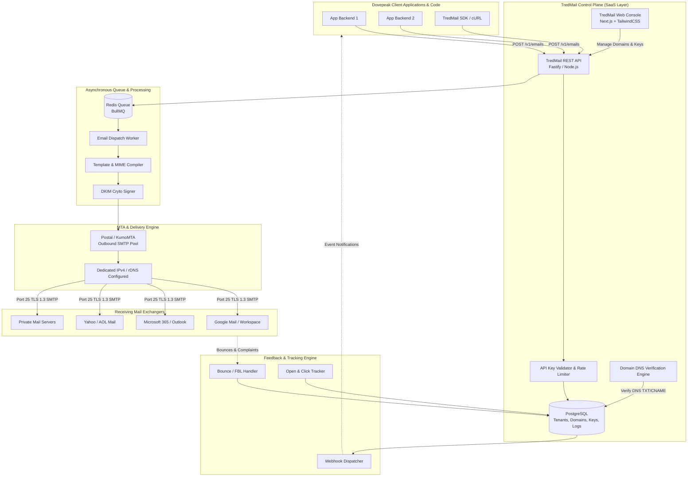

<p align="center"></p>

# TredMail
> **An Enterprise-Grade, Self-Hosted Transactional & Marketing Email Platform**  
> *A product of Dovepeak Technologies*

---

## Executive Summary

**TredMail** is Dovepeak Technologies’ in-house alternative to commercial mail delivery platforms like **Resend**, **Postmark**, and **SendGrid**. It provides developer-friendly REST APIs, instant domain verification (DKIM, SPF, DMARC), email delivery queues, live tracking (opens, clicks, bounces), webhooks, and a modern management console.

### Key Objectives
1. **Zero Recurring SaaS Tolls**: Eliminate per-email and tier-based recurring fees from 3rd-party email providers.
2. **Unlimited Internal Volume**: Provide seamless, unmetered access for all Dovepeak systems and client projects.
3. **Enterprise Deliverability**: Achieve inbox placement rates equal to or higher than commercial providers by implementing strict RFC compliance, automated DKIM signing, dedicated IP reputation management, and automated warm-up protocols.
4. **Commercial SaaS Ready**: Built modularly so it can be transformed into a multi-tenant, billing-ready commercial product when Dovepeak decides to commercialize.

---

## Core Questions Answered

### 1. Is this possible?
**Yes, 100% possible.** In fact, commercial providers like Resend and Postmark are essentially:
1. A modern REST API and developer experience (dashboard, API keys, webhooks).
2. A fast queueing and template rendering engine.
3. A Mail Transfer Agent (MTA) operating on dedicated IP addresses with proper DNS authentication (rDNS, SPF, DKIM, DMARC).

Email itself is a decentralized internet standard (SMTP / RFC 5321). Dovepeak can run its own MTA cluster, own its IP reputation, and never pay a third party again.

### 2. What tools and frameworks can be seamlessly used?

| Layer | Recommended Choice | Alternatives | Why? |
| :--- | :--- | :--- | :--- |
| **MTA (Delivery Engine)** | **Postal** or **KumoMTA** | Stalwart, Haraka, Postfix | **Postal** is an open-source SendGrid/Postmark clone with full DKIM, bounce handling, and webhooks out-of-the-box. **KumoMTA** is the next-gen Rust MTA designed for high-scale API sending. |
| **Backend & API** | **Node.js (TypeScript) / Fastify** or **Go** | Next.js API, NestJS | High throughput, sub-10ms response times for email ingestion (`POST /v1/emails`). |
| **Queue / Buffer** | **Redis + BullMQ** | RabbitMQ, Asynq (Go) | Handles high concurrency, automatic retries, backoff, and rate-limiting per receiving domain. |
| **Database** | **PostgreSQL (with Prisma/Drizzle)** | MySQL, ClickHouse (for high-volume analytics) | ACID compliance for API keys, domains, suppression lists, and email logs. |
| **Frontend Dashboard** | **Next.js 14+ (App Router)** | Vite + React | Modern developer console for API keys, domain verification, live email inspection, and metrics. |
| **DNS Verification** | **Native Node.js `dns.promises`** / Cloudflare DoH | dnspython | Automated polling of TXT/CNAME records to verify domain ownership and DNS health. |

### 3. What are the core requirements?
1. **Server with Clean IP & Port 25 Open**: Hetzner, OVH, Scaleway, or Linode VPS with outbound Port 25 unblocked.
2. **Reverse DNS (PTR Record)**: Resolving the IP address directly back to your mail server FQDN (e.g. `mail.tredmail.dovepeak.com`).
3. **Cryptographic DNS Authentication**:
   - **SPF**: Authorizing Dovepeak's mail servers.
   - **DKIM**: Auto-generating 2048-bit RSA / Ed25519 keypairs per sending domain.
   - **DMARC**: Strict reject/quarantine policies.
   - **Return-Path (Custom Envelope From)**: CNAME setup for bounce capturing.
4. **IP Warm-up Protocol**: Gradual volume scaling to earn trust with Gmail, Yahoo, and Microsoft Outlook.
5. **Suppression & Compliance Engine**: Automatic blacklisting of hard bounces and spam complaints (mandated by Google & Yahoo 2024 rules).

---

## Architecture Overview



---

## Detailed Documentation Directory

The complete technical blueprint is structured into the following deep-dive guides:

- 📑 [System Architecture & Stack Blueprint](docs/ARCHITECTURE.md)
  * Detailed breakdown of components, MTA comparison (Postal vs KumoMTA vs SES Hybrid), queue design, and data flows.
- 🔑 [API Specification & SDK Design](docs/API_SPECIFICATION.md)
  * Resend-compatible REST API endpoints, request/response models, code examples (Node.js, Python, cURL), and error handling.
- 🛡️ [Deliverability, Infrastructure & Compliance Guide](docs/DELIVERABILITY_AND_INFRASTRUCTURE.md)
  * Port 25 unblocking, rDNS setup, SPF/DKIM/DMARC generator algorithms, IP warmup schedules, and 2024+ Yahoo/Google rules.
- 🗄️ [Database Schema (Prisma)](packages/db/prisma/schema.prisma)
  * Production-ready schema for Tenants, Users, Domains, API Keys, Messages, Delivery Events, Suppressions, and Webhooks.
- 🚀 [Implementation Roadmap & Step-by-Step Build Plan](docs/ROADMAP_AND_IMPLEMENTATION.md)
  * Phase-by-phase execution plan from local prototype to production cloud deployment.

---

## Quick Comparison: TredMail vs Commercial Providers

| Feature | Resend / Postmark | SendGrid | TredMail (Dovepeak Technologies) |
| :--- | :--- | :--- | :--- |
| **Pricing at 500k emails/mo** | ~$400 - $650 / month | ~$350 / month | **~$25 - $40 / month** (server costs only) |
| **Pricing at 2M emails/mo** | ~$1,500+ / month | ~$1,000+ / month | **~$60 - $100 / month** |
| **API Experience** | Excellent (Developer-first) | Legacy / Complex | **Identical to Resend** (modern REST + JSON) |
| **Domain Verification** | Automatic DKIM/SPF UI | Manual / Clunky | **Instant Automated Verification UI** |
| **Data Privacy & Control** | Stored on 3rd-party servers | Stored on 3rd-party servers | **100% Owned by Dovepeak Technologies** |
| **Vendor Lock-in** | High | High | **Zero Lock-in** |
| **Commercialization** | Cannot resell | Expensive partner tier | **Ready to white-label / monetize** |

---

## Getting Started (local development)

**Prerequisites:** Node.js 22+, Docker Desktop.

### Repository layout

| Path | What it is |
| --- | --- |
| `apps/api` | Fastify API: sending, domains, keys, webhooks, accounts (Better Auth at `/api/auth`) |
| `apps/worker` | Delivery worker: DKIM signing, tracking links, SMTP hand-off |
| `apps/console` | Next.js console on the Dovepeak brand (separate npm project) |
| `packages/core` | Shared config, security, DNS, queue, send service, email templates |
| `packages/db` | Prisma schema, migrations and client |
| `packages/sdk-node` | Node.js SDK (unpublished) |

### First run

1. **Configure.** Copy `.env.example` to `.env`. Set `TREDMAIL_MASTER_ENCRYPTION_KEY`, `INTERNAL_API_TOKEN` and `BETTER_AUTH_SECRET`, each to the output of `openssl rand -hex 32`. Set `WEBHOOK_ALLOW_PRIVATE_TARGETS=true` to test webhooks against `localhost`.
2. **Start backing services** (PostgreSQL 5435, Redis 6389, Mailpit 1035/8035):
   ```bash
   docker compose up -d
   ```
3. **Install, migrate and seed:**
   ```bash
   npm install && npm install --prefix apps/console
   npm run db:deploy
   npm run db:seed   # prints an owner login and an API key ONCE; store them in a password manager
   ```
   The seed creates the platform workspace (owner of `tredmail.dovepeak.com`, used for account emails and the sandbox sender) and the Dovepeak workspace. In development both domains are marked verified so mail flows to Mailpit; anywhere else they must pass real DNS verification.
4. **Run everything:**
   ```bash
   npm run dev:all   # API :3000, worker, console :3010
   ```

| Service | URL |
| --- | --- |
| Console | http://localhost:3010 (sign in with the seeded owner, or create an account) |
| Mailpit inbox (verification and test emails land here) | http://localhost:8035 |
| API liveness / readiness | http://localhost:3000/health and /health/ready |

### How a new user gets started

Sign up, confirm the email (it arrives in Mailpit locally), create a workspace, then press **Send test email** on the Overview page. The sandbox sender (`onboarding@tredmail.dovepeak.com`) can email workspace members' verified addresses, 50 per day, before any DNS work. Adding and verifying a domain lifts that restriction.

### Checks

```bash
npm run typecheck && npm run lint && npm test         # what CI runs for the API and worker
npm run build:console                                 # console build and type check
TREDMAIL_API_KEY=tred_live_... npm run test:smoke     # send -> worker -> Mailpit -> tracking
npm run test:accounts                                 # sign-up, workspace, sandbox, invitations, roles
```

### Security rules

- Never commit API keys, webhook secrets or `.env`. CI runs gitleaks on every pull request.
- API keys and member roles share one permission model (`emails:send`, `domains:manage`, `api_keys:manage`, `full_access`, ...). Give services the narrowest key that works.
- If a key leaks: `npm run keys:revoke -- <key>` (or `node apps/api/dist/cli/revoke-api-key.js <key>` in the production image), then issue a new one.

### Production

`deploy-hostinger.sh` provisions Docker, generates every secret, applies migrations and seeds the organization. The production stack does not yet include an MTA or bounce handling (roadmap Phase 2).
