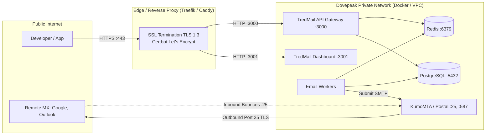

# TredMail Architecture & Technical Blueprint

This document specifies the technical architecture of **TredMail**, Dovepeak Technology's self-hosted transactional email infrastructure.

---

## 1. System Architecture Overview

TredMail is decoupled into three primary subsystems:

1. **Control Plane (API & Console)**: Handles authentication, domain registration, DNS verification checks, API key lifecycle, webhook subscriptions, and analytics reporting.
2. **Data Pipeline (Ingestion & Queue)**: Ingests email requests via high-performance REST endpoints, validates inputs, suppresses invalid/bounced recipients, enqueues jobs to Redis, compiles MIME messages, and signs emails with domain-specific cryptographic DKIM keys.
3. **MTA (Delivery & Feedback)**: Manages outbound SMTP connections over Port 25 with STARTTLS, coordinates connection pools, handles retry queues, processes asynchronous bounce events, and handles open/click tracking.

```
+-----------------------------------------------------------------------------------+
|                            Dovepeak Applications / SDK                            |
+-----------------------------------------------------------------------------------+
                                         |
                                         | HTTPS (Bearer tred_live_xxx)
                                         v
+-----------------------------------------------------------------------------------+
|                        TREDMAIL API GATEWAY (Fastify/Node.js)                     |
|  - API Key Auth & Scopes             - Rate Limiter (Token Bucket)                |
|  - Schema Validation (Zod)           - Idempotency Cache                          |
|  - Suppression List Check            - Event Logging                              |
+-----------------------------------------------------------------------------------+
             |                                             |
             v                                             v
+-----------------------------+               +-------------------------------------+
|      PostgreSQL Database    |               |             Redis Buffer            |
|  - Domains & DKIM Keys      |               |  - BullMQ Priority Ingestion Queue  |
|  - API Keys & Permissions   |               |  - Rate-limiting counters           |
|  - Message Logs & Metadata  |               +-------------------------------------+
|  - Webhook Endpoints        |                                  |
+-----------------------------+                                  v
                                              +-------------------------------------+
                                              |       EMAIL WORKER PIPELINE         |
                                              |  - MIME Body & Header Compiler      |
                                              |  - Tracking Pixel & Link Rewriter   |
                                              |  - RSA-2048 / Ed25519 DKIM Signer   |
                                              +-------------------------------------+
                                                                 |
                                                                 v
+-----------------------------------------------------------------------------------+
|                             MAIL TRANSFER AGENT (MTA)                             |
|  Options: Postal (Full-featured) OR KumoMTA (Rust-based high-throughput)         |
|  - Connection Pooling per MX domain       - IP Pool Selection & Warm-up Manager   |
|  - TLS 1.3 Negotiation & DANE             - Asynchronous Retry & Backoff Engine   |
+-----------------------------------------------------------------------------------+
                                         |
                                         | Outbound SMTP (Port 25 TLS)
                                         v
+-----------------------------------------------------------------------------------+
|                      RECEIVING MAIL SERVERS (Google, Yahoo, etc.)                 |
+-----------------------------------------------------------------------------------+
```

---

## 2. Choosing the MTA Delivery Engine

The Mail Transfer Agent (MTA) is the engine that actually speaks SMTP to remote internet mail exchangers (Google, Microsoft, Apple, Yahoo). Building an MTA from scratch is unneeded because industry-standard, battle-tested open-source MTAs exist.

Below is an engineering comparison of the best options for Dovepeak:

### Option A: Postal (Recommended for fastest time-to-market)
* **What it is**: An open-source, full-featured transactional mail platform written in Ruby & Go, originally developed by Kualo.
* **Pros**:
  - Acts exactly like SendGrid/Mailgun out-of-the-box.
  - Built-in web UI, API, domain verification, DKIM signing, bounce parsing, IP pools, and click/open tracking.
  - Very stable, deployed in thousands of production infrastructures.
* **Cons**: Uses more RAM (Docker stack requires ~3–4GB minimum).
* **Verdict**: **Best turnkey option.** Dovepeak can either wrap Postal's API with TredMail's branded interface or deploy Postal as the backend MTA engine directly.

### Option B: KumoMTA (Recommended for ultimate scalability & custom control)
* **What it is**: A modern, cloud-native Mail Transfer Agent written in **Rust**, designed by the former architects of SparkPost and MessageSystems.
* **Pros**:
  - Blazing fast performance (can handle tens of thousands of messages per second on modest hardware).
  - Native Lua-based routing policies: easily configure IP warmup schedules, automated traffic shaping per recipient MX (e.g. Gmail vs Yahoo limits), and custom webhook emissions.
  - Very low memory footprint (starts in ~100MB RAM).
  - Modern observability: Prometheus metrics, structured JSON logs.
* **Cons**: Focused purely on delivery; requires building your own control plane dashboard and database (which TredMail provides!).
* **Verdict**: **Best enterprise engine.** If Dovepeak wants total proprietary control over its control plane, pairing **TredMail Next.js/Fastify** with **KumoMTA** creates an elite, Resend-level architecture.

### Option C: The Hybrid "Safety Pipe" Model (Amazon SES as the underlying MTA)
* **What it is**: Dovepeak runs the TredMail UI, API, domain verification, and API key management, but routes outbound SMTP through Amazon SES.
* **Cost**: Amazon SES costs **$0.10 per 1,000 emails** ($10 per 100,000 emails).
* **Pros**: Zero deliverability management, zero risk of IP blacklisting, 100% uptime from day 1.
* **Cons**: Still pays a tiny commodity fee (though 90% cheaper than SendGrid or Resend).
* **Verdict**: Excellent as an initial stepping stone or as an automatic fallback route while warming up dedicated self-hosted IPs.

---

## 3. Core Component Breakdown

### 3.1 TredMail API Gateway
* **Technology**: Node.js with **Fastify** (or Go).
* **Responsibilities**:
  1. **Authentication**: Validates incoming API keys (`tred_live_...` or `tred_test_...`) using SHA-256 hashed keys stored in PostgreSQL.
  2. **Domain Matching**: Confirms that the `from` email address matches a verified domain owned by the tenant.
  3. **Suppression Guard**: Instantly rejects emails sent to addresses flagged as Hard Bounce or Spam Complaint (saving compute and protecting sender reputation).
  4. **Queue Enqueueing**: Pushes the valid email payload into a Redis priority queue (`bullmq:emails`) and immediately returns a `200 OK` with an `id: "msg_abc123"`.

### 3.2 Domain Verification Engine
For Dovepeak to send professional emails without landing in spam, domains must be authenticated:
1. When a user registers `acme.com` in TredMail:
   - TredMail generates a unique 2048-bit RSA keypair.
   - Private key is encrypted with AES-256-GCM and stored in PostgreSQL.
   - Public key is formatted as a DNS TXT record for DKIM: `tredmail._domainkey.acme.com`.
   - TredMail defines the recommended SPF record: `v=spf1 include:_spf.tredmail.dovepeak.com ~all`.
   - TredMail defines the DMARC record: `v=DMARC1; p=quarantine; rua=mailto:dmarc@tredmail.dovepeak.com`.
   - TredMail defines the Return-Path CNAME: `bounces.acme.com -> bounces.tredmail.dovepeak.com`.
2. The Verification Worker periodically queries public DNS servers using Node.js `dns.promises.resolveTxt` and `resolveCname`. Once all 4 records match, the domain status flips to `verified`.

### 3.3 Email Worker & DKIM Signer
* Pops jobs from Redis.
* Merges variables if using dynamic templates.
* Compiles compliant RFC 5322 MIME messages (including `Message-ID`, `Date`, `To`, `From`, `Subject`, `List-Unsubscribe`, `MIME-Version`, `Content-Type`).
* Generates cryptographic DKIM header:
  - Hashes headers and body using SHA-256 (`rsa-sha256`).
  - Signs with domain's private key.
  - Appends `DKIM-Signature:` header to the MIME message.
* Hands the complete signed MIME stream to the MTA (via local SMTP or direct queue).

### 3.4 Tracking & Feedback Pipeline
* **Open Tracking**: Embeds an invisible 1x1 transparent GIF (``).
* **Click Tracking**: Rewrites hyperlinks (`<a href="https://track.tredmail.dovepeak.com/click/msg_abc123?target=https%3A%2F%2Fmyapp.com">`). When clicked, records the event in PostgreSQL, issues a 302 redirect, and dispatches a webhook.
* **Bounce Handling**:
  - Receiving mail servers send non-delivery notifications (DSN / RFC 3464) to the envelope `Return-Path` (`bounces@bounces.tredmail.dovepeak.com`).
  - The inbound bounce listener parses the recipient, bounce code (e.g. `550 5.1.1 User unknown`), categorizes it as **Hard Bounce** or **Soft Bounce**, writes to the `suppressions` table, and emits a `email.bounced` webhook.

---

## 4. Network & Security Architecture



### Security Measures:
1. **API Key Hashing**: Plaintext keys (`tred_live_...`) are presented to the user only once. In the database, only the `sha256(key)` is stored.
2. **Encrypted Private Keys**: DKIM private keys stored in the database are encrypted at rest with an environment master key (`AES_256_GCM`).
3. **Strict Egress Rules**: Outbound Port 25 is restricted solely to the MTA container/process to prevent any accidental open relays.
4. **Rate Limiting**: Configured per API key (e.g. 100 requests/sec default) using Redis sliding window algorithms to prevent denial-of-service or quota abuse.
