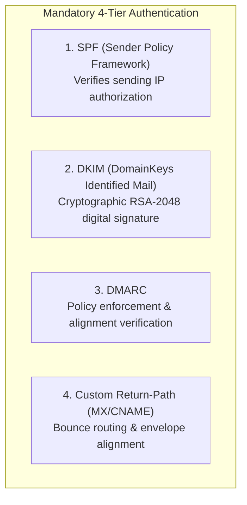

# TredMail Deliverability, Infrastructure & Compliance Guide

Deliverability is the foundation of any email platform. Building the API and database is standard software engineering, but achieving **99%+ inbox placement** into Gmail, Microsoft 365/Outlook, and Yahoo requires strict adherence to infrastructure standards, cryptographic signing, and reputation protocols.

---

## 1. Server & IP Infrastructure Requirements

### 1.1 Outbound Port 25 & Cloud Providers
Mail servers communicate over **Port 25 (SMTP)**. Most modern cloud providers (AWS EC2, DigitalOcean, Google Cloud, Vultr) block outbound Port 25 by default to combat spam.

| Cloud Provider | Port 25 Policy | Recommendation for TredMail |
| :--- | :--- | :--- |
| **OVHcloud** | Open by default | **Highly Recommended**. Excellent IP reputation, dedicated servers, affordable. |
| **Hetzner** | Blocked initially; unblocked upon request after 1st paid invoice | **Highly Recommended**. Best price-to-performance VPS ($5-$15/mo), very stable. |
| **Linode / Akamai**| Blocked initially; opened upon support ticket detailing use case | **Recommended**. Fast support ticket resolution for legitimate businesses. |
| **AWS EC2** | Blocked; can submit "Request removal of email sending limits" form | Viable, but strict approval process. |
| **DigitalOcean** | Strictly blocked on almost all new accounts | Not recommended for self-hosted MTA. |

### 1.2 Dedicated IP Reputation & rDNS (PTR Record)
1. **Never use shared or "dirty" IPs**: Before accepting a server IP, test it against global DNS blacklists using tools like [Spamhaus](https://www.spamhaus.org/), [Barracuda](https://www.barracudacentral.org/), and [MXToolbox](https://mxtoolbox.com/blacklists.aspx).
2. **Reverse DNS (PTR Record)**:
   - A forward DNS record points a hostname to an IP: `mail.tredmail.dovepeakdigital.com -> 198.51.100.25`.
   - The PTR record **MUST** resolve the IP back to the exact same hostname: `198.51.100.25 -> mail.tredmail.dovepeakdigital.com`.
   - Both forward and reverse records must match (`FCrDNS` - Forward-Confirmed Reverse DNS).
   - *Failure to configure rDNS will result in 100% rejection by Google, Microsoft, and Yahoo.*

---

## 2. Cryptographic Email Authentication (The Big 4)

Every domain sending through TredMail must configure 4 DNS records. TredMail automatically computes these and presents them in the user dashboard:



### 2.1 SPF (Sender Policy Framework)
* **Type**: `TXT`
* **Name**: `@` (or sending domain, e.g. `dovepeakdigital.com`)
* **Value**:
  ```text
  v=spf1 include:_spf.tredmail.dovepeakdigital.com ~all
  ```
* **Explanation**: Declares that servers authorized in Dovepeak's SPF include record have permission to transmit messages on behalf of the domain.

### 2.2 DKIM (DomainKeys Identified Mail)
* **Type**: `TXT`
* **Name**: `tredmail._domainkey.yourdomain.com`
* **Key Spec**: 2048-bit RSA keypair (generated dynamically per tenant domain).
* **Value**:
  ```text
  v=DKIM1; k=rsa; p=MIIBIjANBgkqhkiG9w0BAQEFAAOCAQ8AMIIBCgKCAQEA0...
  ```
* **How TredMail works**:
  1. The API generates a public/private keypair using Node.js `crypto.generateKeyPairSync('rsa', { modulusLength: 2048 })`.
  2. Public key is published in DNS.
  3. Private key is encrypted with AES-256 and stored in the database.
  4. Outbound workers sign headers (`From`, `To`, `Subject`, `Date`, `Message-ID`, `List-Unsubscribe`) and the email body, placing the `DKIM-Signature` header on every outbound MIME.

### 2.3 DMARC (Domain-based Message Authentication)
* **Type**: `TXT`
* **Name**: `_dmarc.yourdomain.com`
* **Value (Initial - Monitoring Phase)**:
  ```text
  v=DMARC1; p=none; rua=mailto:dmarc-reports@tredmail.dovepeakdigital.com; pct=100;
  ```
* **Value (Production - Enforced Phase)**:
  ```text
  v=DMARC1; p=quarantine; rua=mailto:dmarc-reports@tredmail.dovepeakdigital.com; pct=100;
  ```
* **Explanation**: Instructs receiving inboxes on how to handle emails that fail SPF or DKIM checks, preventing impersonation and phishing.

### 2.4 Custom Return-Path (Envelope-From / Bounce CNAME)
* **Type**: `CNAME`
* **Name**: `bounces.yourdomain.com`
* **Value**: `bounces.tredmail.dovepeakdigital.com`
* **Explanation**: Allows TredMail to receive asynchronous delivery status notifications (DSN / bounces) directly and ensures SPF alignment passes on the Return-Path.

---

## 3. Strict 2024+ Google & Yahoo Sender Mandates

As of early 2024, Google (Gmail) and Yahoo enforce strict requirements for all senders. Senders who violate these are dropped straight into spam or rejected:

1. **Both SPF and DKIM Must Be Configured**: No exceptions.
2. **DMARC Record Must Exist**: Even if `p=none` initially.
3. **Spam Complaint Rate Below 0.10%**: Senders must never exceed a **0.30%** spam complaint rate in Google Postmaster Tools.
4. **Mandatory One-Click Unsubscribe (RFC 8058)**:
   For marketing or batch mailings, TredMail must automatically append these headers:
   ```http
   List-Unsubscribe-Post: List-Unsubscribe=One-Click
   List-Unsubscribe: <https://track.tredmail.dovepeakdigital.com/unsubscribe/token123>, <mailto:unsubscribe@bounces.tredmail.dovepeakdigital.com?subject=unsubscribe-token123>
   ```
5. **TLS Encryption**: Outbound SMTP connections must negotiate TLS (STARTTLS).
6. **Matching Forward and Reverse DNS (rDNS)**.

---

## 4. IP Warm-Up Protocol (Crucial for Fresh IPs)

When TredMail is launched with a brand-new IP address, receiving providers (Gmail, Outlook) have **zero reputation history** for that IP. Sending 10,000 emails on Day 1 will cause immediate rate-limiting (421 deferrals) and spam filtering.

### Recommended 30-Day Automated Warm-Up Schedule

| Day Range | Max Emails / Day | Suggested Target | Handling Deferrals (Greylisting) |
| :--- | :--- | :--- | :--- |
| **Day 1 - 3** | 50 - 100 | High-engagement transactional only (e.g. password resets, magic links) | Back off immediately on 421 codes |
| **Day 4 - 7** | 200 - 500 | Active internal Dovepeak transactional alerts | Keep retry delay at 15–30 mins |
| **Day 8 - 14**| 1,000 - 2,500 | Expansion to welcome emails and notifications | Monitor Google Postmaster Tools |
| **Day 15 - 21**| 5,000 - 10,000| Steady transactional + first newsletter batches | Watch spam rate (target < 0.05%) |
| **Day 22 - 30**| 25,000 - 50,000| Full transactional & marketing integration | IP considered "Established" |
| **Day 31+** | 100,000+ / day | Unmetered standard operation | Normal queue operation |

> [!TIP]
> **Warm-up Automation in TredMail**: TredMail's Redis BullMQ queue can be configured with a sliding-window rate limiter per destination domain:
> - E.g. Limit outbound connections to `*@gmail.com` to 10 emails/minute on Day 1, doubling the cap daily.

---

## 5. Reputation Monitoring & Postmaster Tools

Dovepeak should register its sending IPs and domains in these free postmaster programs:

1. **Google Postmaster Tools (GPT)** (`postmaster.google.com`):
   - Real-time dashboard showing IP Reputation (Bad / Low / Medium / High).
   - Domain Reputation.
   - Spam rate percentage.
   - DKIM/SPF/DMARC success rates.
2. **Microsoft SNDS & JMRP** (`sendersupport.olc.protection.outlook.com`):
   - Smart Network Data Services (SNDS): View spam trap hits and complaint rates on Microsoft inboxes (@outlook.com, @hotmail.com).
   - Junk Mail Reporting Program (JMRP): Automated feedback loop that emails Dovepeak whenever a user clicks "Report Spam".
3. **Yahoo Complaint Feedback Loop (CFL)**:
   - Automated delivery of spam complaint events.

---

## 6. Bounce & Suppression Logic

TredMail maintains a persistent `suppressions` table in PostgreSQL:

| Event Type | SMTP Code Example | TredMail Action |
| :--- | :--- | :--- |
| **Hard Bounce (Permanent)** | `550 5.1.1 User unknown` | **Immediately added to suppression list**. Future API requests for this email address are rejected with `400 Bad Request: Recipient is suppressed`. |
| **Soft Bounce (Temporary)** | `452 4.2.2 Mailbox full` or `421 Service unavailable` | Retried up to 5 times with exponential backoff over 48 hours. If all retries fail, flagged as temporary failure without permanent suppression. |
| **Spam Complaint** | Feedback Loop (FBL) webhook | **Immediately added to suppression list**. |
| **Unsubscribe** | User clicked One-Click Unsubscribe | Added to unsubscribe list for the tenant. |
