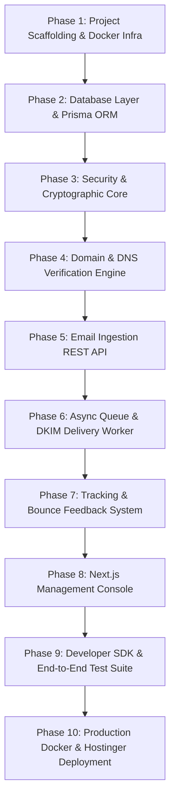

# TredMail Master Build Plan (End-to-End Execution)

This master plan guides the end-to-end implementation of **TredMail**, building a self-hosted, enterprise-grade transactional and marketing email platform for Dovepeak Technology.

---

## Architecture Stack Summary

- **Backend / Ingestion API**: Node.js (TypeScript) + Fastify (sub-15ms ingestion response time).
- **Console / Management Dashboard**: Next.js 14+ (App Router) + Tailwind CSS + Lucide Icons + Tremor/Recharts.
- **Queue & Async Processing**: Redis 7 + BullMQ (sliding window rate-limiting per destination domain).
- **Database & ORM**: PostgreSQL 16 + Prisma ORM.
- **Cryptographic Engine**: Node.js `crypto` (RSA-2048 DKIM key generation, AES-256-GCM private key encryption, SHA-256 API key hashing).
- **MTA / Delivery Pipeline**:
  - *Local Development / Test*: **Mailpit** (built-in local SMTP + visual web dashboard at `:8025`).
  - *Production*: **Postal** or **KumoMTA** (outbound Port 25 SMTP with TLS 1.3).
- **Tracking & Webhooks**: Transparent 1x1 GIF open tracking, link rewriting redirect proxy, HMAC-SHA256 signed webhooks.

---

## 10-Phase End-to-End Roadmap

---

### Phase 1: Project Scaffolding & Local Infrastructure
* **Goal**: Establish the repository structure, package management, TypeScript configuration, and boot local Docker backing services (PostgreSQL, Redis, Mailpit).
* **Deliverables**:
  - Root `package.json` with workspace configuration (`packages/core`, `apps/api`, `apps/web`).
  - Shared TypeScript (`tsconfig.json`) and linting setup.
  - Initialized Git repository with proper `.gitignore`.
  - Local infrastructure launched via `docker-compose.yml`.
  - Verified network connectivity between containers and host.

---

### Phase 2: Database Layer & Prisma Schema
* **Goal**: Model all domain entities, generate typesafe database clients, and create initial database migrations.
* **Deliverables**:
  - Prisma schema with models: `Organization`, `User`, `ApiKey`, `Domain`, `Email`, `EmailEvent`, `Suppression`, `Webhook`, `WebhookDelivery`.
  - Migration script to generate database tables in PostgreSQL.
  - Seed script creating default Dovepeak tenant and initial administrator account.
  - Typesafe database client export.

---

### Phase 3: Security & Cryptographic Core
* **Goal**: Build all cryptographic and authentication services required by modern email standards.
* **Deliverables**:
  - **AES-256-GCM Encryption Service**: For encrypting/decrypting DKIM private keys at rest.
  - **RSA-2048 Keypair Generator**: Automatically creates high-entropy RSA keypairs for DKIM.
  - **API Key Manager**: Generates scoped `tred_live_...` keys, hashes with SHA-256, and verifies bearer tokens.
  - **Password & Session Auth**: Secure authentication utilities for console users.

---

### Phase 4: Domain & DNS Verification Engine
* **Goal**: Enable self-service domain onboarding with automated DNS validation.
* **Deliverables**:
  - DNS record generator: computes DKIM TXT record, SPF TXT recommendation, DMARC TXT record, and Return-Path CNAME.
  - Live DNS resolver service using Node.js `dns.promises`:
    - Checks `tredmail._domainkey.<domain>` for valid public key.
    - Checks `<domain>` for SPF inclusion.
    - Checks `_dmarc.<domain>` for DMARC policy.
    - Checks `bounces.<domain>` CNAME target.
  - REST endpoints: `GET /v1/domains`, `POST /v1/domains`, `POST /v1/domains/:id/verify`.

---

### Phase 5: Email Ingestion REST API (Resend Compatible)
* **Goal**: Provide an ultra-fast REST API for application code to send emails.
* **Deliverables**:
  - Fastify HTTP server with Zod schema validation.
  - `POST /v1/emails` (single email) & `POST /v1/batch` (batch up to 100 emails).
  - `GET /v1/emails/:id` (inspect delivery status).
  - Suppression check: Automatically blocks sending to addresses marked as hard-bounced or spam complaints.
  - Fast ingestion: Pushes payload to Redis queue and responds in < 15ms.

---

### Phase 6: Async Queue, MIME Compiler & DKIM Signer
* **Goal**: Process queued emails in the background, compile RFC 5322 MIME messages, attach cryptographic DKIM signatures, and transmit over SMTP.
* **Deliverables**:
  - Redis BullMQ worker process.
  - MIME compilation engine: handles HTML, plaintext fallback, custom headers, and file attachments.
  - DKIM Signer: Signs email headers and body with domain's private key (`rsa-sha256`).
  - RFC compliance: Injects `Message-ID`, `Date`, `List-Unsubscribe` (One-Click / RFC 8058).
  - SMTP Client: Delivers to SMTP target (Mailpit in development; Postal/KumoMTA in production) with automatic retry and backoff on transient errors.

---

### Phase 7: Tracking Engine & Bounce / Feedback System
* **Goal**: Track opens, clicks, and handle bounce/complaint feedback.
* **Deliverables**:
  - Tracking server endpoints:
    - `GET /open/:emailId`: Serves 1x1 transparent GIF, records `OPENED` event with IP and User-Agent.
    - `GET /click/:emailId?url=...`: Records `CLICKED` event, issues 302 redirect.
  - Inbound bounce handler: Parses DSN non-delivery reports (5xx hard vs 4xx soft bounces).
  - Suppression list auto-insertion for hard bounces and spam complaints.
  - Webhook dispatcher: Sends real-time signed JSON webhooks to subscriber URLs with retry logic.

---

### Phase 8: Modern Web Console UI (Next.js 14+)
* **Goal**: A high-polish developer management console inspired by Resend, Vercel, and Postmark.
* **Deliverables**:
  - **Overview**: Real-time volume, delivery rate, open rate, and bounce rate charts.
  - **Live Email Inspector**: Feed of sent emails with chronological delivery audit timeline (`queued` -> `sent` -> `delivered` -> `opened`) and rendered HTML preview.
  - **Domain Management**: Domain setup wizard with 1-click copy for DNS records and live "Verify DNS" button.
  - **API Keys**: Create keys with scopes, copy secret once, revoke keys.
  - **Suppressions**: Searchable list of blocked addresses with manual unblock capability.
  - **Webhooks**: Endpoint registration and test ping utility.

---

### Phase 9: Developer SDK & End-to-End Test Suite
* **Goal**: Provide official SDKs and automated test scripts to ensure 100% reliability.
* **Deliverables**:
  - `@dovepeak/tredmail` Node.js/TypeScript SDK client.
  - Drop-in compatibility testing: Verifying that standard `@resend/node` code works seamlessly with TredMail simply by pointing `baseUrl`.
  - Comprehensive automated test script that sends emails, verifies Mailpit receipt, checks DKIM headers, simulates opens/clicks, and triggers webhooks.

---

### Phase 10: Production Docker & Hostinger Deployment Playbook
* **Goal**: Package the entire system for production deployment on Hostinger KVM VPS.
* **Deliverables**:
  - Production `Dockerfile` and `docker-compose.prod.yml`.
  - Caddy / Nginx reverse proxy configuration with automatic SSL (Let's Encrypt).
  - Hostinger hPanel configuration checklist (rDNS PTR setup, firewall, Port 25 verification).
  - Automated deployment and backup scripts.
